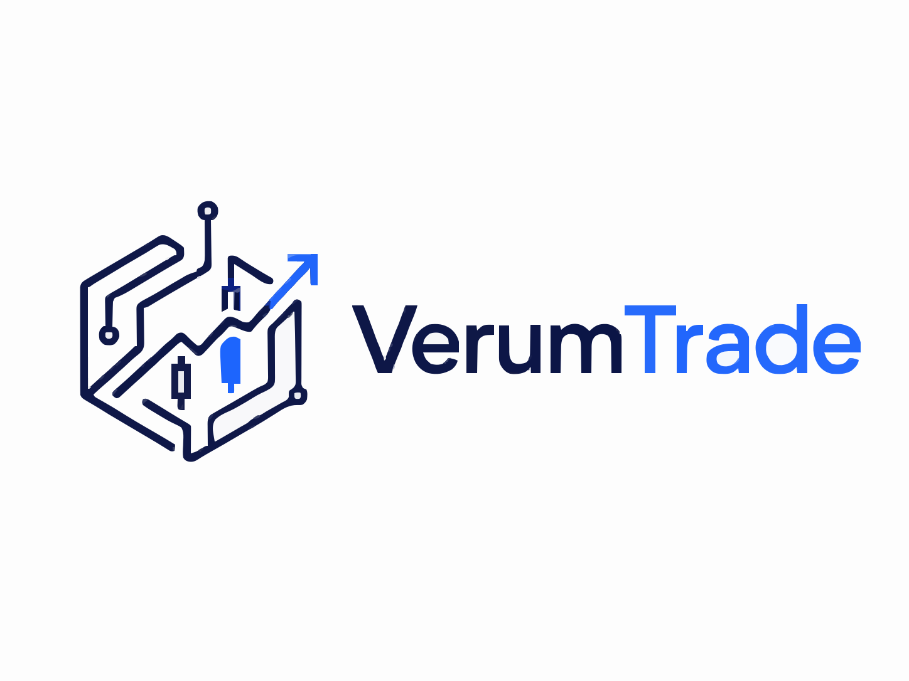
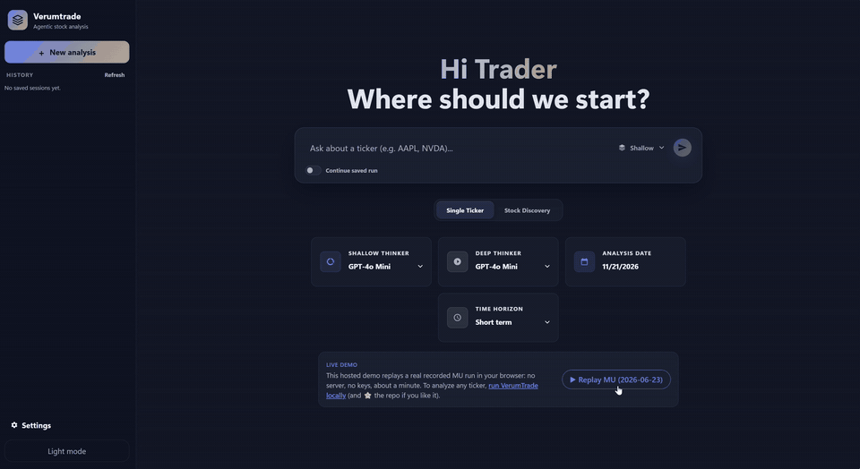
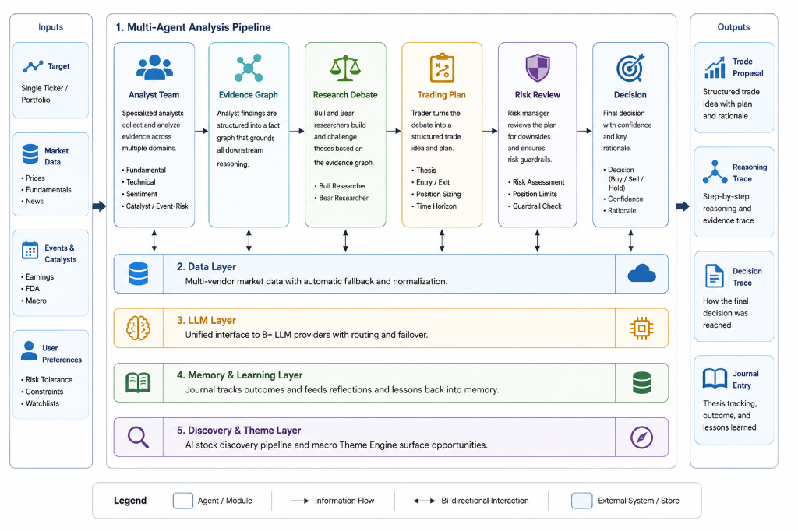

<div align="center">
  

  <p>
    <a href="README.md">English</a>
    ·
    <a href="README.zh-CN.md">简体中文</a>
  </p>

  <p><em>An open-source multi-agent LLM framework for stock research, with visible reasoning and a decision trace from raw evidence to the final trade proposal.</em></p>

  <p>
    <a href="LICENSE"></a>
    
    
    <a href="https://github.com/muye1202/VerumTrade/actions/workflows/tests.yml"></a>
    <a href="https://github.com/muye1202/VerumTrade/actions/workflows/docker.yml"></a>
  </p>

  <p>
    <a href="https://muye1202.github.io/VerumTrade/demo/"><b>▶ Live demo in your browser ↗</b></a>
    ·
    <a href="#-try-it-in-60-seconds--no-api-keys">Run it locally without API keys</a>
    ·
    <a href="https://muye1202.github.io/VerumTrade/demos/example-reports/MU-2026-06-23.html">View an example report ↗</a>
  </p>

  <a href="https://muye1202.github.io/VerumTrade/demo/"></a>
  <p><sub>A recorded MU run playing in the <a href="https://muye1202.github.io/VerumTrade/demo/">live demo</a> (sped up 2.5×). Click it to replay the run yourself, right in your browser.</sub></p>
</div>

---

## 🔭 What is VerumTrade?

VerumTrade turns market data, fundamentals, news, sentiment, and catalysts into a **transparent
trade thesis** instead of a black-box buy/sell signal. *Verum* is Latin for "truth": every decision
comes with evidence you can inspect and reasoning you can audit.

```text
Analysts → Evidence graph → Bull/Bear debate → Trader plan → Risk review → Decision + trace
```

It builds on [Tauric Research's TradingAgents](https://github.com/tauricresearch/tradingagents) and adds:

- 🔎 **Reasoning & decision traces**: every step from evidence to final decision, rendered in the web UI.
- 🔗 **Evidence graph**: analyst findings become structured, citable facts that ground the debate.
- 🗞️ **Catalyst & event-risk analyst**: earnings, FDA, and macro catalysts.
- 🛡️ **Crowding & macro-pullback awareness**: flags crowded, extended names in a fragile tape.
- 🛰️ **AI stock discovery**: screens the market, then analyzes the strongest candidates.
- 🔌 **Bring your own model & data**: 9 LLM providers (including local Ollama), Yahoo Finance with no key, and automatic vendor fallback.
- 💸 **Optional paper or live trading** through Alpaca, with position-size and concentration guardrails.

> [!IMPORTANT]
> VerumTrade is a research and decision-support tool, not financial advice. Paper-trade first and
> make any real-money decision yourself. See the [Disclaimer](#%EF%B8%8F-disclaimer).

---

## ▶ Try it in 60 seconds — no API keys

**Fastest:** [open the live demo ↗](https://muye1202.github.io/VerumTrade/demo/) and click
**▶ Replay MU**. It runs entirely in your browser.

To run the same replay locally, use Docker:

```bash
git clone https://github.com/muye1202/VerumTrade.git && cd VerumTrade
docker compose up --build
```

Or Python 3.10+ and Node 20.19+:

```bash
git clone https://github.com/muye1202/VerumTrade.git && cd VerumTrade
pip install -e .
cd frontend && npm install && cd ..
python run.py
```

Then open <http://localhost:5173> and click **▶ Replay MU (2026-06-23)**.

---

## 🚀 Analyze your own tickers

1. **Add one LLM key.** Copy `.env.example` to `.env` and fill in any one provider key (OpenAI,
   Anthropic, Google, DeepSeek, Azure Foundry, Qwen, GLM, OpenRouter, or a local Ollama model).
   Market data works with no key through Yahoo Finance; optional Alpaca, Alpha Vantage, Twelve Data,
   and Finnhub keys add coverage. [`.env.example`](.env.example) lists them all.
2. **Start the app** with `python run.py` (or `docker compose up` again after editing `.env`).
3. **Open <http://localhost:5173>**, enter a ticker, and watch the agents work. Completed runs are
   saved in **History**.

Two ways to start:

- **Single ticker analysis:** you have a stock in mind and want an auditable thesis, with a
  final report, traces, risk notes, and an optional Alpaca order.
- **Stock discovery:** switch the app to Discovery mode. It screens a universe through catalyst,
  theme, inflection, and attention-gap stages, then ranks candidates with evidence packs and thesis
  cards and analyzes the top names.

> [!TIP]
> A **Shallow** run with small models takes about 1–3 minutes and costs a few cents. **Deep** runs
> with reasoning models take several minutes and can cost $0.50–$2+. Start shallow.

<details>
<summary><b>More ways to run: CLI, Python API, Docker options, separate terminals</b></summary>

<br>

**CLI.** A guided terminal flow for single-ticker, portfolio, and discovery runs. Results go to
`results/stocks/{date}/{ticker}/`.

```bash
verumtrade analyze               # or: python -m cli.main analyze
verumtrade analyze-portfolio     # triage your Alpaca positions, then analyze the ones that need attention
verumtrade --help
```

**Python API.**

```python
from dotenv import load_dotenv
from verumtrade.default_config import DEFAULT_CONFIG
from verumtrade.graph.verumtrade_graph import VerumtradeGraph

load_dotenv()
config = DEFAULT_CONFIG.copy()
config["llm_provider"] = "google"        # or "openai", "anthropic", "deepseek", ...
config["deep_think_llm"] = "gemini-2.5-flash"
config["quick_think_llm"] = "gemini-2.0-flash"

state, decision = VerumtradeGraph(config=config).propagate("NVDA", "2024-05-10")
print(decision)
```

**Docker.** The web app is served by nginx on `:5173` and proxies `/api` and WebSockets to the
FastAPI backend on `:8000`. History lives in the `verumtrade-data` volume
(`docker compose down --volumes` deletes it). Change host ports with
`VERUMTRADE_WEB_PORT=8080 VERUMTRADE_API_PORT=8001 docker compose up`.

**Separate terminals** (for clearer logs): `uvicorn api.main:app --reload` and
`cd frontend && npm run dev`.

**Replay-only server** for public demos: `VERUMTRADE_DEMO_MODE=1` makes every analysis play a
recording, so no model is called. Recordings and the tools that build them live in
[`demos/replays/`](demos/replays).

</details>

---

## 🔬 Reasoning & decision traces

Every analysis answers "*why this trade?*" at each step, and the web UI lets you expand any agent's
contribution:

```text
Evidence graph   →  "Q3 revenue +18% YoY; RSI 71 (overbought); insider selling last week"
Research debate  →  Bull: durable demand · Bear: valuation stretched → Manager: cautious BUY
Trader plan      →  BUY, LIMIT @ $X, size 10% of buying power
Risk review      →  Conservative trims size; Risk Judge approves with concentration cap
Final decision   →  { action: BUY, order_type: LIMIT, qty: ..., rationale: ... }
```

<sub>Illustrative. The final decision is a structured object validated against
[`decision_schema.py`](verumtrade/graph/decision_schema.py); the reasoning trace comes from
[`reasoning_trace.py`](verumtrade/graph/reasoning_trace.py), and the evidence graph from
[`evidence_graph.py`](verumtrade/agents/utils/agent_runtime/evidence_graph.py).</sub>

---

## 🏗️ Architecture

Each agent is a node in a [LangGraph](https://github.com/langchain-ai/langgraph) workflow:



Agents use one of two model slots. A **quick-thinking** model (`quick_think_llm`) runs the analysts,
researchers, trader, and risk debaters. A **deep-thinking** model (`deep_think_llm`) makes the key
calls: research manager, risk judge, and portfolio triage.

**Crowding & macro-pullback awareness.** A once-per-run macro regime snapshot, a per-ticker
**Pullback Vulnerability Score** (0–100, from extension, crowding, tape fragility, and valuation),
and peer/sector read-through (peers' earnings dates, sector basket beta) feed the risk judge. On a
HIGH or CRITICAL rating, the judge steers toward smaller size or waiting for a trigger.

---

## ⚙️ Configuration

Defaults live in [`verumtrade/default_config.py`](verumtrade/default_config.py). The ones you'll
change most:

| Key | Controls | Example / default |
|:--|:--|:--|
| `llm_provider` | LLM backend | `openai` · `anthropic` · `google` · `deepseek` · `azure-foundry` · `openrouter` · `qwen3-cn` · `glm` · `ollama` |
| `deep_think_llm` / `quick_think_llm` | Model per tier | `"gemini-2.5-flash"` / `"gemini-2.0-flash"` |
| `max_debate_rounds` | Bull ↔ Bear rounds | `1` (max `3`) |
| `data_vendors` | Preferred vendor per data category, with automatic fallback | `alpaca` · `yfinance` · `alpha_vantage` · `twelve_data` · `local` |
| `alpaca_execution.enabled` / `.paper_trading` | Trading on/off, paper vs. live | `false` / `true` |
| `alpaca_execution.position_size_pct` / `.max_concentration_pct` | Sizing guardrails | `0.10` / `0.20` |
| `VERUMTRADE_CONTEXT_BUDGET_MODE` (env) | Prompt compression: `adaptive`, `compact`, or `off` | `adaptive` |

---

## 🧰 Troubleshooting

| Symptom | Fix |
|:--|:--|
| Auth or `No API key` errors | Check `.env`: you need one valid LLM key. |
| HTTP 400, context length exceeded | Keep `VERUMTRADE_CONTEXT_BUDGET_MODE=adaptive` or use `compact`. |
| HTTP 429, rate limited | Use a smaller model or shallower depth, or raise `VERUMTRADE_RESEARCH_MANAGER_MIN_DELAY_S` / `VERUMTRADE_RISK_MANAGER_MIN_DELAY_S`. |
| UI loads but calls fail | The backend isn't running on `http://localhost:8000`. |
| `npm run dev` fails | Use Node ≥ 20.19 and run `npm install` in `frontend/`. |

---

## 🤝 Contributing

Contributions are welcome, from research ideas to engineering fixes. See
[`CONTRIBUTING.md`](CONTRIBUTING.md) for dev setup, tests, and the PR process, and
[`CODE_OF_CONDUCT.md`](CODE_OF_CONDUCT.md).

<details>
<summary><b>📚 Citation</b></summary>

<br>

If you use VerumTrade in academic work, please cite this repository ([`CITATION.cff`](CITATION.cff))
and the upstream TradingAgents framework:

```bibtex
@software{verumtrade,
  title  = {VerumTrade: A multi-agent AI trading framework with visible reasoning and decision traces},
  author = {Jia, Muye},
  year   = {2026},
  url    = {https://github.com/muye1202/VerumTrade}
}

@misc{tradingagents,
  title        = {TradingAgents: Multi-Agents LLM Financial Trading Framework},
  author       = {Tauric Research},
  howpublished = {\url{https://github.com/tauricresearch/tradingagents}}
}
```

</details>

**Credits.** Built on [TradingAgents](https://github.com/tauricresearch/tradingagents) by Tauric
Research. We're grateful for their pioneering work on multi-agent LLM systems for trading.

---

## ⚠️ Disclaimer

VerumTrade is a research and educational decision-support tool. It is not financial advice and is
not an independent investment decision maker. Market data can be incomplete or delayed, LLM output
can be wrong, and trading involves risk of loss. Inspect the evidence, paper-trade first, and make
any real-money decision yourself. The authors are not responsible for financial losses from using
this software.

## 📄 License

[Apache License 2.0](LICENSE)
