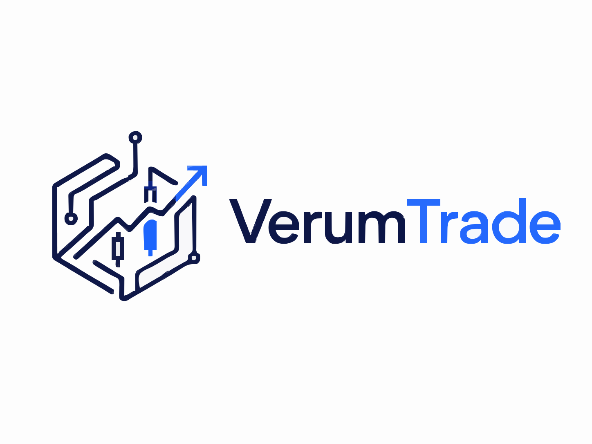
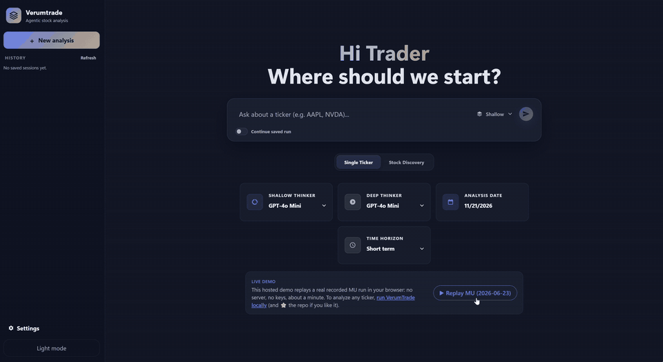
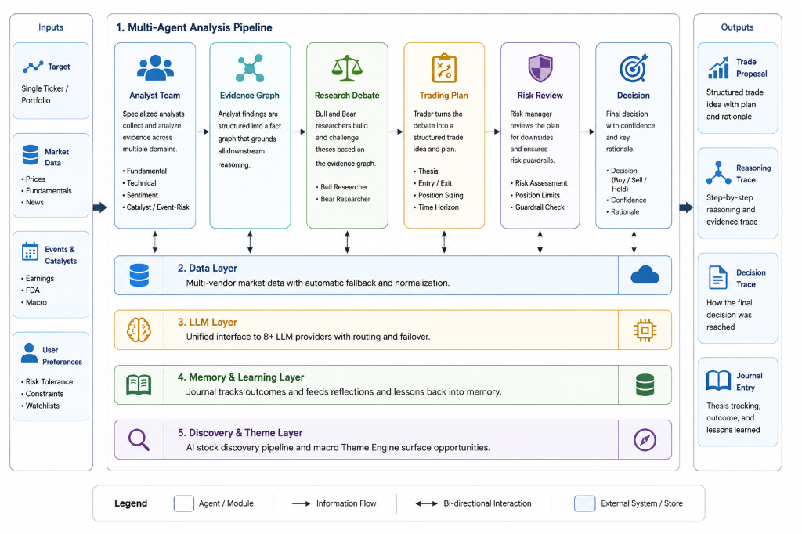

<div align="center">
  

  <p>
    <a href="README.md">English</a>
    ·
    <a href="README.zh-CN.md">简体中文</a>
  </p>

  <p><em>开源的多智能体 LLM 股票研究框架：从原始证据到最终交易提案，全程保留可见的推理与决策轨迹。</em></p>

  <p>
    <a href="LICENSE"></a>
    
    
    <a href="https://github.com/muye1202/VerumTrade/actions/workflows/tests.yml"></a>
    <a href="https://github.com/muye1202/VerumTrade/actions/workflows/docker.yml"></a>
  </p>

  <p>
    <a href="https://muye1202.github.io/VerumTrade/demo/"><b>▶ 浏览器内在线演示 ↗</b></a>
    ·
    <a href="#try-without-keys">本地免 API Key 体验</a>
    ·
    <a href="https://muye1202.github.io/VerumTrade/demos/example-reports/MU-2026-06-23.html">查看美光示例分析 ↗</a>
  </p>

  <a href="https://muye1202.github.io/VerumTrade/demo/"></a>
  <p><sub>在<a href="https://muye1202.github.io/VerumTrade/demo/">在线演示</a>中播放的一次真实 MU 分析录制（2.5 倍速）。点击即可在浏览器中亲自回放。</sub></p>
</div>

---

<a id="what-is-verumtrade"></a>

## 🔭 VerumTrade 是什么？

VerumTrade 把行情、基本面、新闻、情绪和催化事件转化为**透明的交易论点**，而不是黑箱式的买入/卖出信号。
*Verum* 是拉丁语的"真相"：每个决策都附带可检查的证据和可审计的推理。

```text
分析师 → 证据图谱 → 多空辩论 → 交易员计划 → 风控审查 → 决策 + 轨迹
```

它基于 [Tauric Research 的 TradingAgents](https://github.com/tauricresearch/tradingagents)，并新增：

- 🔎 **推理与决策轨迹**：从证据到最终决策的每一步，都在 Web UI 中呈现。
- 🔗 **证据图谱**：分析师的发现被提炼为结构化、可引用的事实，作为辩论的依据。
- 🗞️ **催化/事件风险分析师**：财报、FDA 与宏观催化事件。
- 🛡️ **拥挤度与宏观回撤感知**：在脆弱行情中标记拥挤、过度上涨的标的。
- 🛰️ **AI 股票发现**：先筛选市场，再深入分析最强的候选标的。
- 🔌 **自选模型与数据**：9 家 LLM 提供商（含本地 Ollama），Yahoo Finance 无需 Key，数据源自动回退。
- 💸 **可选的模拟或实盘交易**：通过 Alpaca 执行，带仓位与集中度护栏。

> [!IMPORTANT]
> VerumTrade 是研究与决策辅助工具，不构成投资建议。请先模拟交易，真实资金决策由你自己做出。参见[免责声明](#disclaimer)。

---

<a id="try-without-keys"></a>

## ▶ 60 秒体验 — 无需任何 API Key

**最快的方式：**[打开在线演示 ↗](https://muye1202.github.io/VerumTrade/demo/)，点击 **▶ Replay MU**，
完全在浏览器中运行。

想在本地运行同样的回放，可以用 Docker：

```bash
git clone https://github.com/muye1202/VerumTrade.git && cd VerumTrade
docker compose up --build
```

或使用 Python 3.10+ 与 Node 20.19+：

```bash
git clone https://github.com/muye1202/VerumTrade.git && cd VerumTrade
pip install -e .
cd frontend && npm install && cd ..
python run.py
```

然后打开 <http://localhost:5173>，点击 **▶ Replay MU (2026-06-23)**。

---

<a id="analyze-your-own"></a>

## 🚀 分析你自己的股票

1. **添加一个 LLM Key。** 将 `.env.example` 复制为 `.env`，填入任意一家提供商的 Key（OpenAI、Anthropic、
   Google、DeepSeek、Azure Foundry、通义千问、智谱 GLM、OpenRouter，或本地 Ollama 模型）。行情数据通过
   Yahoo Finance 免 Key 即可使用；可选的 Alpaca、Alpha Vantage、Twelve Data、Finnhub Key 可扩展覆盖。
   完整列表见 [`.env.example`](.env.example)。
2. **启动应用：** `python run.py`（Docker 用户修改 `.env` 后重新运行 `docker compose up`）。
3. **打开 <http://localhost:5173>**，输入股票代码，观看智能体工作。完成的分析会保存在 **History** 中。

两种使用方式：

- **单股票分析：** 你已有目标股票，需要一份可审计的论点，包括最终报告、轨迹、风险提示，以及可选的 Alpaca 订单。
- **股票发现：** 在应用中切换到 Discovery 模式。它会经过催化、主题、拐点和关注度缺口等阶段筛选股票池，
  用证据包和论点卡片为候选排序，并深入分析排名靠前的标的。

> [!TIP]
> 使用小模型的 **Shallow** 分析约需 1–3 分钟、花费几美分；使用推理模型的 **Deep** 分析需要数分钟，
> 花费约 $0.50–$2+。建议先从 Shallow 开始。

<details>
<summary><b>更多运行方式：CLI、Python API、Docker 选项、分终端启动</b></summary>

<br>

**CLI。** 引导式终端流程，支持单股票、持仓组合和股票发现。结果保存在 `results/stocks/{date}/{ticker}/`。

```bash
verumtrade analyze               # 或：python -m cli.main analyze
verumtrade analyze-portfolio     # 筛查你的 Alpaca 持仓，并深入分析最需要关注的标的
verumtrade --help
```

**Python API。**

```python
from dotenv import load_dotenv
from verumtrade.default_config import DEFAULT_CONFIG
from verumtrade.graph.verumtrade_graph import VerumtradeGraph

load_dotenv()
config = DEFAULT_CONFIG.copy()
config["llm_provider"] = "google"        # 或 "openai"、"anthropic"、"deepseek" 等
config["deep_think_llm"] = "gemini-2.5-flash"
config["quick_think_llm"] = "gemini-2.0-flash"

state, decision = VerumtradeGraph(config=config).propagate("NVDA", "2024-05-10")
print(decision)
```

**Docker。** Web 应用由 nginx 在 `:5173` 提供，并将 `/api` 与 WebSocket 代理到 `:8000` 的 FastAPI 后端。
分析历史保存在 `verumtrade-data` 卷中（`docker compose down --volumes` 会删除）。端口被占用时可用
`VERUMTRADE_WEB_PORT=8080 VERUMTRADE_API_PORT=8001 docker compose up` 修改。

**分终端启动**（日志更清晰）：`uvicorn api.main:app --reload` 与 `cd frontend && npm run dev`。

**仅回放服务器**（用于公开演示）：设置 `VERUMTRADE_DEMO_MODE=1` 后，每次分析都会播放录制内容，不会调用任何模型。
录制文件及其构建工具位于 [`demos/replays/`](demos/replays)。

</details>

---

<a id="reasoning--decision-traces"></a>

## 🔬 推理与决策轨迹

每次分析都会在每一步回答"*为什么做这笔交易？*"，你可以在 Web UI 中展开任一智能体的贡献：

```text
证据图谱   →  "Q3 营收同比 +18%；RSI 71（超买）；上周内部人减持"
研究辩论   →  多头：需求持续 · 空头：估值偏高 → 经理：谨慎买入
交易员计划 →  BUY，LIMIT @ $X，仓位为购买力的 10%
风控审查   →  保守派削减仓位；风控法官批准并设定集中度上限
最终决策   →  { action: BUY, order_type: LIMIT, qty: ..., rationale: ... }
```

<sub>示意。最终决策是按 [`decision_schema.py`](verumtrade/graph/decision_schema.py) 校验的结构化对象；推理轨迹来自
[`reasoning_trace.py`](verumtrade/graph/reasoning_trace.py)，证据图谱来自
[`evidence_graph.py`](verumtrade/agents/utils/agent_runtime/evidence_graph.py)。</sub>

---

<a id="architecture"></a>

## 🏗️ 架构

每个智能体都是 [LangGraph](https://github.com/langchain-ai/langgraph) 工作流中的一个节点：



智能体使用两个模型槽位之一。**快速思考**模型（`quick_think_llm`）负责分析师、研究员、交易员和风控辩手；
**深度思考**模型（`deep_think_llm`）负责关键决策：研究经理、风控法官和持仓筛查。

**拥挤度与宏观回撤感知。** 每次运行生成的宏观环境快照、单只股票的**回撤脆弱度评分**（0–100，综合涨幅延伸、
拥挤度、行情脆弱度与估值）以及同行/板块联动（同行财报日期、板块篮子贝塔）都会输入风控法官。评级为 HIGH 或
CRITICAL 时，法官会倾向于减小仓位或等待触发信号。

---

<a id="configuration"></a>

## ⚙️ 配置

默认值位于 [`verumtrade/default_config.py`](verumtrade/default_config.py)。最常调整的选项：

| 配置项 | 作用 | 示例 / 默认值 |
|:--|:--|:--|
| `llm_provider` | LLM 后端 | `openai` · `anthropic` · `google` · `deepseek` · `azure-foundry` · `openrouter` · `qwen3-cn` · `glm` · `ollama` |
| `deep_think_llm` / `quick_think_llm` | 各层模型 | `"gemini-2.5-flash"` / `"gemini-2.0-flash"` |
| `max_debate_rounds` | 多空辩论轮数 | `1`（最多 `3`） |
| `data_vendors` | 各数据类别的首选数据源，支持自动回退 | `alpaca` · `yfinance` · `alpha_vantage` · `twelve_data` · `local` |
| `alpaca_execution.enabled` / `.paper_trading` | 交易开关、模拟或实盘 | `false` / `true` |
| `alpaca_execution.position_size_pct` / `.max_concentration_pct` | 仓位护栏 | `0.10` / `0.20` |
| `VERUMTRADE_CONTEXT_BUDGET_MODE`（环境变量） | 提示词压缩：`adaptive`、`compact` 或 `off` | `adaptive` |

---

<a id="troubleshooting"></a>

## 🧰 故障排查

| 现象 | 解决方法 |
|:--|:--|
| 认证或 `No API key` 错误 | 检查 `.env`：需要一个有效的 LLM Key。 |
| HTTP 400，上下文长度超限 | 保持 `VERUMTRADE_CONTEXT_BUDGET_MODE=adaptive`，或改用 `compact`。 |
| HTTP 429，被限流 | 换用更小的模型或更浅的深度，或调大 `VERUMTRADE_RESEARCH_MANAGER_MIN_DELAY_S` / `VERUMTRADE_RISK_MANAGER_MIN_DELAY_S`。 |
| 界面能打开但请求失败 | 后端没有在 `http://localhost:8000` 运行。 |
| `npm run dev` 失败 | 使用 Node ≥ 20.19，并在 `frontend/` 中运行 `npm install`。 |

---

<a id="contributing"></a>

## 🤝 贡献

欢迎贡献，无论是研究想法还是工程修复。开发环境、测试与 PR 流程见 [`CONTRIBUTING.md`](CONTRIBUTING.md)，
社区准则见 [`CODE_OF_CONDUCT.md`](CODE_OF_CONDUCT.md)。

<details>
<summary><b>📚 引用</b></summary>

<br>

如果你在学术工作中使用 VerumTrade，请引用本仓库（[`CITATION.cff`](CITATION.cff)）以及上游 TradingAgents 框架：

```bibtex
@software{verumtrade,
  title  = {VerumTrade: A multi-agent AI trading framework with visible reasoning and decision traces},
  author = {Jia, Muye},
  year   = {2026},
  url    = {https://github.com/muye1202/VerumTrade}
}

@misc{tradingagents,
  title        = {TradingAgents: Multi-Agents LLM Financial Trading Framework},
  author       = {Tauric Research},
  howpublished = {\url{https://github.com/tauricresearch/tradingagents}}
}
```

</details>

**致谢。** 本项目基于 Tauric Research 的 [TradingAgents](https://github.com/tauricresearch/tradingagents)，
感谢原作者在多智能体 LLM 交易系统方面的开创性工作。

---

<a id="disclaimer"></a>

## ⚠️ 免责声明

VerumTrade 是研究与教育用途的决策辅助工具，不构成投资建议，也不是独立的投资决策者。行情数据可能不完整或延迟，
LLM 输出可能出错，交易存在亏损风险。请检查证据、先模拟交易，真实资金决策由你自己做出。作者不对使用本软件造成的
任何经济损失负责。

<a id="license"></a>

## 📄 许可证

[Apache License 2.0](LICENSE)
